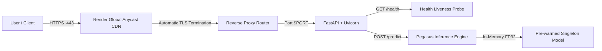

# 🌐 Render Production Deployment Guide — SummarizeAI

> **Production PaaS Web Service Deployment for Google Pegasus Text Summarization**  
> *Zero Docker / AWS required — Native Python GitOps deployment with automated zero-downtime health probes.*

---

## 📑 Table of Contents
1. [Overview & Architecture](#overview--architecture)
2. [Prerequisites](#prerequisites)
3. [Method A: 1-Click Blueprint Deploy (Recommended)](#method-a-1-click-blueprint-deploy-recommended)
4. [Method B: Manual Render Dashboard Setup](#method-b-manual-render-dashboard-setup)
5. [Memory Sizing & Plan Comparison](#memory-sizing--plan-comparison)
6. [Environment Variables Reference](#environment-variables-reference)
7. [Zero-Downtime Health Probes](#zero-downtime-health-probes)
8. [Custom Domains & Free SSL](#custom-domains--free-ssl)
9. [Troubleshooting & Runbooks](#troubleshooting--runbooks)

---

## Overview & Architecture

Render hosts SummarizeAI as a fully managed native Python web service.



### Key Technical Specs for Render:
- **Framework:** FastAPI 0.115 + Uvicorn
- **Port:** Render dynamically assigns the port via the `$PORT` environment variable. `app.py` binds to `0.0.0.0:$PORT` automatically.
- **Model Ingestion:** Pre-warms into RAM upon application startup via FastAPI's async lifespan handler.
- **Health Check:** Polled every 10 seconds at `/health`.

---

## Prerequisites

1. A free or paid account at [render.com](https://render.com).
2. GitHub account with this repository pushed to your personal or organization profile.
3. Access to [dashboard.render.com](https://dashboard.render.com).

---

## Method A: 1-Click Blueprint Deploy (Recommended)

This repository includes a production-ready Infrastructure-as-Code blueprint file: [`render.yaml`](../render.yaml).

```yaml
version: "1"

services:
  - type: web
    name: summarize-ai
    runtime: python
    buildCommand: pip install --upgrade pip && pip install -r requirements.txt
    startCommand: uvicorn app.py:app --host 0.0.0.0 --port $PORT
    plan: starter # Starter plan (2 GB RAM) recommended for Pegasus 568M model inference
    region: oregon
    healthCheckPath: /health
    autoDeploy: true
    envVars:
      - key: APP_ENV
        value: production
      - key: LOG_LEVEL
        value: INFO
      - key: PYTHON_VERSION
        value: 3.11.9
```

### Steps to Deploy with Blueprint:
1. Push your repository to GitHub:
   ```bash
   git push origin main
   ```
2. Navigate to [dashboard.render.com/blueprints](https://dashboard.render.com/blueprints).
3. Click **New Blueprint Instance**.
4. Select your `End-to-End-NLP-Text-Summarization-with-Hugging-Face-Transformers` repository.
5. Render reads `render.yaml`, configures Python 3.11, the build command, start command, and health checks.
6. Click **Apply**.
7. Render will build the environment, install dependencies, pre-warm the model, and launch the service.

---

## Method B: Manual Render Dashboard Setup

If you prefer configuring via the web interface:

### Step 1: Create Web Service
1. Log in to [dashboard.render.com](https://dashboard.render.com).
2. Click **New +** → **Web Service**.
3. Choose **Build and deploy from a Git repository** → click **Next**.
4. Connect your GitHub repository.

### Step 2: Configure Service Parameters

| Field | Production Value | Purpose |
|---|---|---|
| **Name** | `summarize-ai` | Sets public domain `summarize-ai.onrender.com` |
| **Region** | `Oregon (US West)` | Choose region closest to users |
| **Branch** | `main` | Production branch |
| **Root Directory** | *(leave blank)* | Root of repository |
| **Runtime** | `Python 3` | Native Python runtime environment |
| **Build Command** | `pip install --upgrade pip && pip install -r requirements.txt` | Installs dependencies |
| **Start Command** | `uvicorn app.py:app --host 0.0.0.0 --port $PORT` | Starts ASGI server on assigned `$PORT` |
| **Instance Type** | **Starter** ($7/mo, 2 GB RAM) | *See memory sizing below* |

### Step 3: Expand Advanced Settings
- **Health Check Path:** `/health`
- **Auto-Deploy:** `Yes` *(Triggers zero-downtime deployment on git push)*

---

## Memory Sizing & Plan Comparison

Google Pegasus (`google/pegasus-cnn_dailymail`) contains 568M parameters. In FP32 on CPU, model weights require **~1.1 GB of RAM**, with inference spikes reaching **~1.4 GB**.

| Tier | Specs | Suitability | Cold-Start Behavior | Cost |
|---|---|---|---|---|
| **Free Tier** | 512 MB RAM / 0.1 CPU | ⚠️ High risk of OOM error | Sleeps after 15 min idle; ~50s spin-up | $0 / mo |
| **Starter Tier** ✅ | **2 GB RAM / 0.5 CPU** | ✅ **Recommended Production** | Never sleeps; instant response | $7 / mo |
| **Standard Tier** | 4 GB RAM / 1.0 CPU | ⚡ High concurrency | Never sleeps; multi-worker | $25 / mo |

> [!IMPORTANT]
> The **Starter tier (2 GB RAM)** is strongly recommended. The Free tier (512 MB) will frequently trigger Render's Out of Memory (OOM) killer during model initialization.

---

## Environment Variables Reference

Configure these in Render Dashboard → **Environment**:

| Variable | Recommended Value | Description |
|---|---|---|
| `APP_ENV` | `production` | Enables production mode |
| `LOG_LEVEL` | `INFO` | Log verbosity |
| `PYTHON_VERSION` | `3.11.9` | Locks exact Python runtime version |
| `TOKENIZERS_PARALLELISM` | `false` | Disables HuggingFace tokenizers multiprocessing warnings |
| `PORT` | *(injected automatically)* | Render sets this dynamically |

---

## Zero-Downtime Health Probes

Render verifies deployments using the `/health` endpoint:

```bash
# Verify health probe manually
curl -i https://summarize-ai.onrender.com/health

# Response:
# HTTP/2 200 OK
# content-type: application/json
# {"status":"healthy","service":"SummarizeAI","model_loaded":true}
```

### Zero-Downtime Deployment Flow:
1. Render spins up a new instance in the background.
2. Render executes the build command and launches Uvicorn.
3. The lifespan handler pre-warms the Pegasus model into memory.
4. Render pings `https://summarize-ai.onrender.com/health`.
5. Only once `/health` returns HTTP 200 does Render switch incoming traffic to the new instance.
6. The old instance is safely drained and terminated. **Zero dropped requests!**

---

## Custom Domains & Free SSL

1. In Render Dashboard, go to **Settings** → **Custom Domains**.
2. Click **Add Custom Domain** and enter your domain (e.g. `summarizer.yourdomain.com`).
3. In your DNS provider (Cloudflare, GoDaddy, Route 53), add a CNAME record:
   - **Type:** `CNAME`
   - **Name:** `summarizer`
   - **Target:** `summarize-ai.onrender.com`
4. Render automatically provisions, verifies, and renews a free **Let's Encrypt SSL/TLS Certificate**.

---

## Troubleshooting & Runbooks

### 1. `Out of Memory (OOM) killed`
- **Symptom:** Build finishes, but logs show `Killed process ... (python)` during pre-warming.
- **Cause:** Using 512 MB Free tier instead of 2 GB Starter tier.
- **Fix:** In Render Dashboard → **Settings** → **Instance Type**, change from Free to **Starter**.

### 2. `Port binding timeout`
- **Symptom:** Service fails to deploy with `Timed out waiting for port`.
- **Cause:** Hardcoding port 8000 instead of listening on `$PORT`.
- **Fix:** Verify Start Command is `uvicorn app.py:app --host 0.0.0.0 --port $PORT`.

### 3. `Clear build cache & redeploy`
- **Action:** If pip encounters transient package index timeouts, click **Manual Deploy** → **Clear build cache & deploy**.
